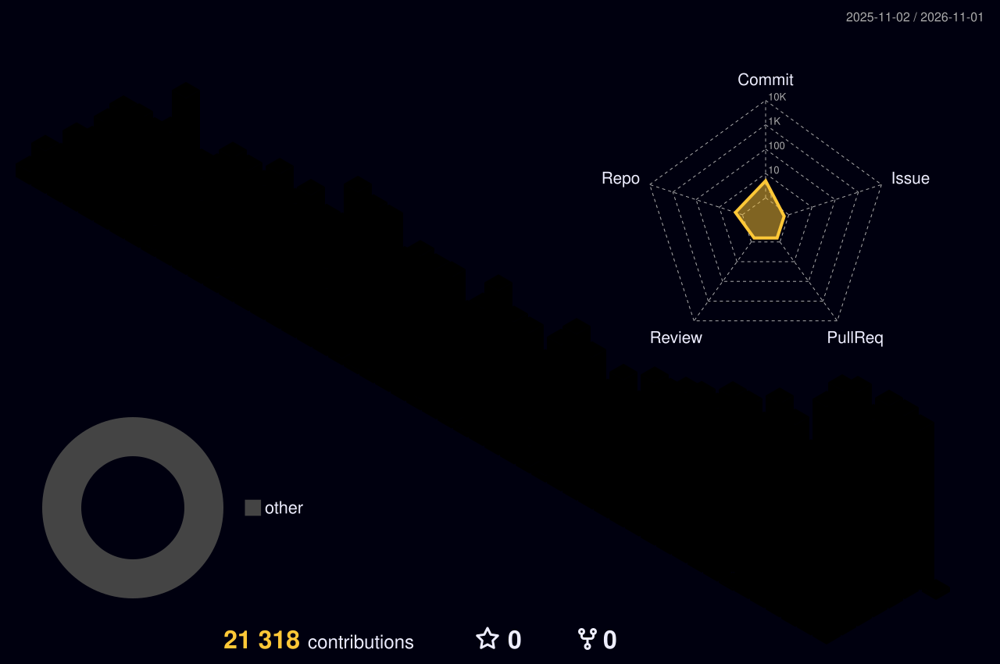

  
  
  
  

## 👋 About me

I sold my first WordPress website in 2019, at 16, started writing real code at 17, and I've built with AI since ChatGPT's first day. I'm a technical co-founder: I co-founded **[Techsy.io](https://techsy.io)**, **WriteWise** and **Rise**, and I built **BetterFit** and the rest of Techsy's product line. Before Techsy I ran an SEO and digital marketing agency, so I build software with **growth, content and distribution** in mind, not just code.

- 🏢 **Co-Founder @ Techsy.io** (2023–present): I build BetterFit and the rest of Techsy's products, multi-agent systems and client platforms
- ✍️ **Co-Founder @ WriteWise** (Nov 2022)
- 📈 **Co-Founder @ Rise** (SIRIUS / Rise Marketing, 2021–2023): automated SEO campaigns, web design and lead-gen funnels
- 🎓 **MEng Software Engineering @ University of Birmingham**: distributed systems, security and reverse engineering
- 🔬 **Final-year research, AXON-0:** a metacognitive latent-space controller for multi-agent LLMs
- 🌍 **Languages:** Turkish (native), English (C1), German (C1, IB German programme)

## 🧭 How I work

- 🧠 **I manage agents like a team.** My own orchestrator, `yonet` (Turkish for *manage*), runs Claude, Codex, Grok and Oh My Pi workers in parallel. It gives each worker a task and checks the result against evidence. Then it retires that worker and briefs a fresh one. Most of my commits are co-written with AI. The craft is in the brief and the review.
- 🪫 **Frugal per call, relentless in total.** Every skill and MCP server on my machine stays off until a task needs it. I still average 207B Claude tokens a month.
- 🛡️ **Careful in production.** I back up the prod database before every deploy and make one commit per change. Secrets stay out of CI, and actions are pinned to exact versions.

## 🤖 AI

#### 🧰 AI toolbelt

                    

## 🧪 Level of work, graded by Claude

I asked Claude (Opus 5.5) to read my repos, including the code, CI, tests and git history, and grade the work without flattery. This is its verdict, condensed:

> **Senior-level technical founder with Staff-level breadth: an architect who ships through AI agents.**

| Dimension | Grade | Evidence |
|---|:-:|---|
| Breadth | **A** | One product, BetterFit, spans Flutter, Swift (watchOS), Kotlin (Wear OS), FastAPI, Next.js, Supabase and PostGIS. Elsewhere: Electron, browser extensions and Payload CMS |
| Architecture | **B+** | Design docs and runbooks with clean seams between services. The web layers sit on MakerKit foundations, and a few UI files run past 1,000 lines |
| Shipping velocity | **A−** | About 23k commits in about 13 months, with a production API and live client sites. Agents inflate the raw count, and the flagship app isn't in the stores yet |
| Testing | **B** | BetterFit has 7,791 passing app tests plus SQL tests, and Akollo has 1,100+ test files. Testing is thin on smaller client sites |
| DevOps & security | **A−** | Self-hosted CI runner on Hetzner, gitleaks, actions pinned to exact versions, no secrets in CI, a server-side deploy lock, row-level security, and Dokploy plus Cloudflare |
| Product sense | **A−** | Pricing by country, in-app purchases and ads, 55 locales, SEO, App Store review prep |

About 89% of my commits carry an AI co-author line, so the commit count measures orchestration, not typing speed. Reviewing what the agents produce is the real skill.

## ⚡ What I do

| | Area | Highlights |
|:-:|---|---|
| 🤖 | **AI & multi-agent systems** | LangGraph and LangChain pipelines, MCP servers, agentic workflows, LLM routing across Claude, OpenAI, Gemini and local models |
| 🌐 | **Full-stack web & SaaS** | Next.js and React monorepos (Turborepo), auth, payments, CMS, i18n and dashboards that ship to production |
| 📱 | **Mobile & wearables** | Flutter (iOS + Android), native SwiftUI, watchOS and Wear OS companions, Swift-to-Android with Skip |
| 📈 | **Marketing, SEO & growth** | Technical SEO audits, Google Ads, Analytics and Tag Manager, funnels, lead generation and marketing automation with n8n |
| ✍️ | **Blogging & content ops** | Automated multilingual blog production, headless CMS (Sanity, Payload, WordPress), content intelligence pipelines |
| 🎨 | **Design & motion** | UI/UX in Figma, Rive and GSAP animation, three.js 3D, Remotion video |
| 🎮 | **Game dev** | Unity and C# (2.5D runners, prototypes), Godot, pixel art in Aseprite |
| 🛡️ | **Security** | Firmware reverse engineering, fuzzing with AFL++, LLDB, Wireshark, OWASP ZAP and secret scanning |
| ☁️ | **Cloud & DevOps** | Cloudflare at the edge, Docker, self-hosted VPS with Dokploy on Hetzner, self-hosted CI runners, GCP and Firebase |

## 🛠️ Tech stack

#### 💻 Languages

  

#### 🟨 The JavaScript / TypeScript universe

  

My daily stack:

| Layer | What I reach for |
|---|---|
| **Frameworks** | Next.js (App Router, RSC), React 19, Vue, Vite, Express, Electron, Remotion |
| **UI & motion** | Tailwind, shadcn/ui, Radix, Motion / Framer Motion, GSAP, three.js + React Three Fiber, Recharts, Tiptap, React Flow, cmdk, Sonner |
| **Data & state** | TanStack Query & Table, Zustand, Drizzle, Supabase JS, Zod, React Hook Form, next-safe-action, GraphQL |
| **Backend & jobs** | Better Auth, Stripe, Payload, Sanity, pg-boss, BullMQ, ioredis, Nodemailer, Resend, Pino |
| **AI SDKs** | Anthropic SDK, OpenAI SDK, Vercel AI SDK, LangChain.js / LangGraph.js, MCP SDK |
| **i18n** | next-intl, i18next |
| **Quality** | Strict TypeScript, Vitest, Playwright, Jest, Storybook, ESLint, Prettier, Biome, dependency-cruiser, Sentry |
| **Build & edge** | Turborepo, pnpm workspaces, esbuild, Wrangler, OpenNext for Cloudflare |

#### ⚙️ Backend & data

   
           

#### 🤖 AI & automation

   
           

#### 📱 Mobile & wearables

   
         

#### ☁️ Cloud, edge & DevOps

   
          

#### 🧑‍💻 IDE & developer experience

   
            

#### 🧹 Dusted toolbox: older tools, still sharp

   
          

Where I started. These aren't my daily drivers anymore, but I shipped real client work with every one of them and can pick any of them back up fast.

#### 🎨 Design, creative & games

   
      

#### 📈 Marketing, SEO & content

        

#### 🛡️ Security & tooling

         

## 🚀 Things I've built

| Project | What it is | Stack |
|---|---|---|
| **BetterFit** | AI fitness and nutrition platform: a Flutter app in 55 languages, a coach app, watchOS and Wear OS companions, a FastAPI server, a geo service and an admin panel | Flutter · Swift · Kotlin · FastAPI · Supabase · PostGIS · Next.js |
| **Akollo** | Time and operations suite with a web app, Electron desktop app, browser extension, background worker and 11 domain modules | Next.js · Electron · Drizzle · pg-boss · Playwright |
| **Aleyna** | Agent-driven marketing system with an orchestrator, cluster leader election, memory, self-improvement and metering | TypeScript · multi-agent |
| **BlogerAgent / SeoPost** | Agent pipelines for research, writing, SEO, images and CMS publishing across many sites and 28+ languages | LangGraph · FastAPI · Sanity |
| **GrowRef** | Two-sided affiliate and referral platform built for Türkiye | Flutter · TypeScript · Docker |
| **Techsy.io & Community** | Company site and community platform, deployed through CI to Dokploy | Next.js 16 · React 19 · Sanity · three.js · Supabase |
| **CMS-Payload** | Multi-tenant Payload CMS with tenant-scoped access | Payload 3 · PostgreSQL |
| **Swift-Kit** | Native iOS starter: SwiftUI + Supabase with Apple and Google sign-in | Swift · SwiftUI · Supabase |
| **Web3Builder** | Visual website builder with 3D, AI content generation and multi-platform export | TypeScript · GrapesJS · three.js |
| **CryptoApp** | iOS financial-education platform with 120+ lectures, virtual trading and gamification | SwiftUI · MVVM · Supabase |
| **AXON-0** | Metacognitive latent-space controller for multi-agent LLMs (final-year research) | Python · PyTorch |

Plus dozens of client builds for clinics, health, logistics, car services, legal tech and sports clubs, mostly in private repos.

## 🔢 GitHub by the numbers

## 📊 GitHub activity

  

<picture>
  <source media="(prefers-color-scheme: dark)" srcset="https://raw.githubusercontent.com/Mertbaturg/Mertbaturg/output/github-contribution-grid-snake-dark.svg"/>
  
</picture>

Building at the intersection of AI, product and growth. Say hi at <a href="mailto:hello@techsy.io">hello@techsy.io</a>. Cards rebuilt by <a href="./scripts/build_profile.py"><code>scripts/build_profile.py</code></a>.

